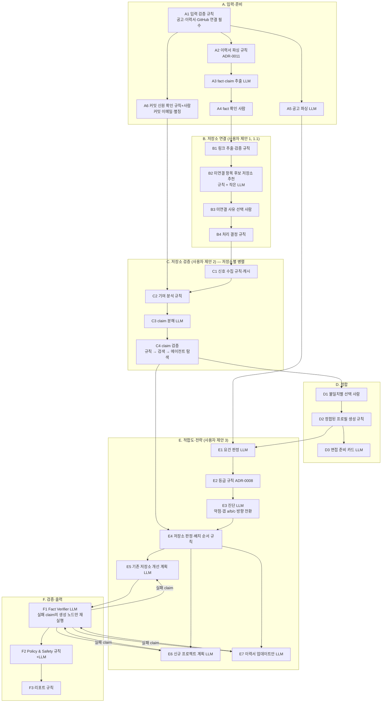

# ADR-0017: 핵심 흐름 그래프 재구성 — 이력서–저장소 정합을 진단보다 먼저

- 상태: 제안됨
- 날짜: 2026-11-01
- 관련: ADR-0002, 0006, 0008, 0009, 0010, 0014, `docs/design.md` §2.2, `docs/ethics/fairness-policy.md` §4

## 배경
사용자가 핵심 흐름을 세 단계로 다시 제안했다.
1. 이력서 항목 중 저장소가 안 적힌 것을 찾고, 그 이유(없음 / 품질 때문에 뺌 / 실수)를 물어 처리한다.
2. 저장소가 적힌 항목은 서술 내용과 실제 구현·커밋 기여가 일치하는지 검증하고, 불일치를 고칠 선택지를 준다.
3. 그렇게 **맞춘 이력서 + GitHub**로 공고 적합도를 판단하고, 어떤 프로젝트를 위로 올리고·빼고·개선할지 알려 준다.

기존 설계(`design.md` §2.2)는 저장소 감사와 요건 판정을 병렬로 돌렸다. 이 구조에서는 **사실과 다른 이력서 문장이 적합도 판정의 근거로 쓰일 수 있다.** 사용자 제안의 핵심은 "사실부터 맞추고 나서 판단한다"이다. RIGOR의 "근거 없는 말은 하지 않는다" 원칙에 더 맞으므로 이 순서를 채택하고, 실서비스에서 터질 지점을 보강해 세분화한다.

## 노드 유형 표기
- **[규칙]**: 결정론 코드. LLM 없음.
- **[LLM]**: 구조화 출력 1회 호출(고정 입력 → 고정 스키마).
- **[사람]**: LangGraph interrupt. 사용자 선택을 기다리고, 재시작 후에도 재개된다.
- **[에이전트]**: LLM이 도구를 골라 반복 호출(tool calling). 읽기 전용 도구, 호출 횟수·토큰 상한.

## 제안 그래프

## 노드 명세

### A. 입력·준비
| 노드 | 유형 | 하는 일 | 사용자 제안 대비 보강 |
|---|---|---|---|
| A1 입력 검증 | 규칙 | 공고 텍스트, 이력서 파일, GitHub App 연결을 확인한다. 하나라도 없으면 시작하지 않는다 | 필수 입력 강제 |
| A2 이력서 파싱 | 규칙 | ADR-0011 경로(텍스트·HWP·OCR) | |
| A3 fact·claim 추출 | LLM | 항목(프로젝트·경력)을 fact로, 그 안의 주장을 **원자 claim**으로 쪼갠다: 기술 / 기능 / 수치 / 역할·기여 / 기간 / 적힌 저장소 URL | 검증 단위를 문장이 아니라 claim으로 |
| A4 fact 확인 | 사람 | 추출 결과를 사용자가 고친다. OCR 신뢰도가 낮은 줄은 강조 표시 | |
| A5 공고 파싱 | LLM | 요건 구조화 (A2~A4와 병렬) | |
| A6 커밋 신원 확인 | 규칙+사람 | GitHub 계정에 연결된 이메일 외에 사용자가 쓴 커밋 이메일·이름 별칭을 확인받는다 | **신규.** 다른 PC의 이메일로 쓴 커밋을 놓치면 기여가 실제보다 적게 잡힌다 |

### B. 저장소 연결 (사용자 제안 1, 1.1)
| 노드 | 유형 | 하는 일 |
|---|---|---|
| B1 링크 추출·검증 | 규칙 | 이력서의 GitHub URL을 저장소로 해석한다. 존재 여부, 접근 가능 여부, 사용자 소유 또는 기여 여부, 포크 여부를 확인한다. 깨진 링크도 여기서 잡는다 |
| B2 후보 저장소 추천 | 규칙 + 작은 LLM | **신규.** 저장소가 안 적힌 항목마다 사용자의 저장소 목록에서 후보를 점수화한다. 기준은 이름·설명·주제 유사도, 커밋 기간과 이력서 기간의 겹침, 사용 기술의 겹침이다. "있는데 실수로 안 적은" 경우를 사용자가 찾지 않아도 되게 한다 |
| B3 미연결 사유 선택 | 사람 | 항목별로 고른다: ① 저장소 없음 ② 있지만 품질 때문에 뺐음 ③ 실수로 안 적음(B2 후보에서 고르거나 URL 입력) ④ 회사·비공개 코드라 공개 불가 |
| B4 처리 결정 | 규칙 | 아래 표 |

B4 처리 규칙. 사용자 원안 "저장소 없으면 빼라"를 세분화했다. 회사 업무나 연구처럼 저장소가 원래 없는 경험까지 빼라고 하면 틀린 조언이 된다.

| 사유 | 항목 종류 | 제안 |
|---|---|---|
| ① 없음 | 개인·팀 프로젝트, 공고 관련 | 다른 근거(데모 URL, 글, 발표 자료)를 연결하거나, 이력서에서 비중을 줄이거나 빼기. 선택은 사용자가 한다 |
| ① 없음 | 경력(회사 업무)·연구 | 유지. 면접 설명 준비 카드(D3)로 보낸다 |
| ② 품질 때문에 뺌 | — | 저장소를 **비공개로 감사**(C)한다. 이후 E4가 "보완해서 연결할 가치가 있는지 / 계속 미연결이 나은지"를 판정한다 |
| ③ 실수 | — | 연결하고 C로 보낸다 |
| ④ 비공개 | — | GitHub App에서 그 저장소를 선택하면 비공개 감사, 아니면 유지 + 면접 준비 |

### C. 저장소 검증 (사용자 제안 2) — 저장소마다 병렬(Send)
| 노드 | 유형 | 하는 일 |
|---|---|---|
| C1 신호 수집 | 규칙·캐시 | ADR-0006 결정론 신호. (repo_id, head_sha)로 캐시 |
| C2 기여 분석 | 규칙 | A6 신원으로 커밋·PR을 귀속한다. 산출: 본인 커밋 비율, 수정한 경로 영역(디렉터리 묶음), 활동 기간, PR 작성·리뷰 여부. **명시적 메타데이터**로 AI 공동 작성(커밋의 `Co-Authored-By` AI 도구 트레일러, 코딩 에이전트 봇 계정이 연 PR)도 센다. 한계 표시: squash merge, 페어 프로그래밍, 대량 이동 커밋은 비율을 왜곡한다 |
| C3 claim 분해 | LLM | A3의 claim 중 이 저장소에 연결된 것을 검증 가능한 질문으로 바꾼다 (예: "LangGraph 사용" → "의존성·import에 langgraph가 있는가") |
| C4 claim 검증 | 규칙 → 검색 → 에이전트 | claim 유형별로 가장 싼 방법부터 쓴다: **기술**·**기간** = 규칙(의존성, 커밋 날짜) / **기능**·**수치** = 근거 파일 검색(ADR-0010) 후 LLM 대조 / 그래도 판단이 안 되는 claim만 **에이전트 탐색**(아래). 결과: supported / not_found / contradicted / unverifiable + 인용 |

### D. 정합 (사용자 제안 2의 선택지)
| 노드 | 유형 | 하는 일 |
|---|---|---|
| D1 불일치별 선택 | 사람 | 아래 선택지 표. 사용자가 "나중에"를 고르면 그 claim은 **확인되지 않은 것**으로 두고 E의 근거에서 빠진다(보수적) |
| D2 정합된 프로필 | 규칙 | 선택을 반영해 fact 상태를 갱신한다: confirmed / revised / unverified |
| D3 면접 준비 카드 | LLM | **신규.** claim별로 면접관이 물을 만한 질문과, 답에 필요한 근거 위치(파일·커밋)를 정리한다. 팀 프로젝트, AI 도구 사용, 수치 claim에 특히 쓴다 |

D1 선택지:

| 불일치 유형 | 선택지 |
|---|---|
| 기술·기능이 코드에 없음 | (a) 이력서를 사실에 맞게 고친다(문장 후보 제시) (b) 저장소에 구현한 뒤 재감사한다 → E5 개선 항목으로 (c) 근거가 다른 곳에 있다 → 링크 추가 후 재검증 |
| 수치 근거 없음 | (a) 수치를 빼거나 측정 조건을 밝혀 고친다 (b) 측정 스크립트·결과를 저장소에 추가한 뒤 재감사한다 |
| 기여가 커밋 근거보다 크게 적힘 | (a) **커밋 근거대로 정직하게 고친다** — 문장 후보 제시, 기본 추천. 예: "5인 팀에서 검색 모듈 담당, 전체 파이프라인 설계 논의 참여" (b) 근거를 보충한다 — 다른 계정·이메일 커밋, PR 리뷰, 이슈, 설계 문서, 페어 작업 기록 → C2 재실행 (c) 그대로 둔다 — 사용자의 이력서이므로 막지 않는다. 다만 리포트에 "근거와 다름"을 남기고, RIGOR가 만드는 문장(E7)에는 쓰지 않는다 |
| AI 도구로 작성한 부분 | 아래 "정직성 원칙" 참고 |

### E. 적합도·전략 (사용자 제안 3)
| 노드 | 유형 | 하는 일 |
|---|---|---|
| E1 요건 판정 | LLM | 정합된 fact + 저장소 근거로 요건별 met/partial/unmet/unknown 판정 |
| E2 등급 | 규칙 | ADR-0008 |
| E3 진단 | LLM | 서류 약점, 갭 (a) 표현 / (b) 사실 부재 / (c) 결격, 방향 전환 |
| E4 저장소 판정·배치 순서 | 규칙 | 저장소별 대표 / 보완 / 제외 판정(루브릭 §4). 이력서 상단 배치 순서 = 공고 관련성 × 품질 × 최근성(가중치는 설정 파일, 근거 기록) |
| E5 기존 저장소 개선 계획 | LLM | 보완 판정 저장소의 개선 항목. 각 항목에 재감사로 확인 가능한 완료 기준(NSM 연결) |
| E6 신규 프로젝트 계획 | LLM | (b) 갭을 메울 새 프로젝트. 마감·가용 시간에 맞춰 범위 조정 |
| E7 이력서 업데이트안 | LLM | 항목 순서 재배치 + (a) 갭 표현 수정. 확인된 fact만 쓴다 |

### F. 검증·출력
- F1 Fact Verifier: E5~E7 출력의 claim을 근거와 대조한다. 실패한 claim을 **만든 노드만** 다시 실행한다(최대 N회, 소진 시 문장 제거 + 리포트 표시). 이전 팀 프로젝트에서 설계한 패턴이다.
- F2 Policy & Safety, F3 리포트.

### 재감사 루프 (나중에)
사용자가 저장소를 고치면 head_sha 변경을 감지해 C만 다시 실행하고, E5의 완료 기준 충족 여부를 판정한다. 충족되면 NSM(ADR-0007)에 반영된다.

## 정직성 원칙 (사용자 원안에서 바꾼 부분)
사용자 원안에는 두 선택지가 있었다. "본인이 했다고 쓰고 공부하기", 그리고 "확실히 설명할 수 있을 때만 거짓으로 적으라고 지적". **RIGOR는 이 두 가지를 선택지로 제안하지 않는다.**

1. **다른 사람(팀원)의 작업을 본인 것으로 쓰는 것은, 설명할 수 있어도 사실 위조다.** 브리프 §5.3(위조 요청 거절)과 ADR-0013의 원칙에 정면으로 어긋난다. 실무적으로도 위험하다. 면접관은 커밋 이력을 볼 수 있고(RIGOR가 바로 그 일을 한다), 팀원이 평판 조회 대상이 될 수 있다.
2. **대신 같은 목적을 정직하게 이루는 방법을 준다.**
   - "설명할 수 있다"는 강점은 이력서의 거짓 문장이 아니라 **면접 준비 카드(D3)**로 살린다. 예: "팀원이 구현한 리랭커의 구조와 선택 이유를 설명할 수 있음" → 면접에서 이해도로 보여 준다.
   - 이력서에는 사실인 표현을 쓴다. 예: "리랭킹 모듈 통합·평가 담당". 이것도 충분히 강하다.
3. **AI 코딩 도구 사용은 부정행위가 아니다.** 사용자가 설계하고, 지시하고, 검토하고, 테스트한 코드는 사용자의 작업으로 써도 된다. RIGOR가 묻는 것은 "설계 결정과 검증 방법을 설명할 수 있는가"이다.
   - **설명할 수 있다** → 그대로 두고 면접 준비 카드를 만든다.
   - **설명하기 어렵다** → 두 길이 있다. 이력서에 쓰기 전에 그 부분을 공부하고 설명을 준비하거나, "AI 코딩 도구를 활용해 구현" 같은 사실 표현으로 고친다.
4. **AI 사용 판별은 명시적 메타데이터와 자기 신고로만 한다.** 근거는 커밋의 AI 공동 작성 트레일러, 코딩 에이전트 봇이 연 PR, 사용자가 프로필에 신고한 구현 방식이다. 코드 문체로 "AI가 썼다"고 추정하지 않는다. 오탐이 사용자를 부당하게 낙인찍기 때문이다. → `fairness-policy.md` §4를 이 내용으로 갱신한다(기존 "탐지하지 않는다"를 "명시적 메타데이터만 쓴다"로 좁힘).

## Tool calling을 어디에 쓰나
"저 노드들이 다 tool calling 아닌가?"에 대한 답이다. **대부분은 아니다.**
- **tool calling**은 *LLM이* 어떤 도구를 어떤 인자로 부를지 고르고, 결과를 보고 다음 호출을 정하는 방식이다.
- 위 그래프에서 다음 노드는 **코드(그래프)가** 정한다. GitHub API도 코드가 직접 부른다. 이것은 워크플로이지 tool calling이 아니다.
- 사용자에게 고르게 하는 단계(A4, B3, D1)는 interrupt다. 이것도 tool calling이 아니다.
- 구조화 출력은 API 내부적으로 tool calling 메커니즘을 빌려 쓰지만, LLM이 도구를 고르는 것은 아니다.

워크플로를 기본으로 하는 이유: 경로를 미리 알 수 있는 작업은 코드가 정하는 편이 **싸고, 재현되고, 테스트할 수 있다.** 같은 근거 → 같은 등급(ADR-0008)도 이 덕분에 지킬 수 있다.

**tool calling이 맞는 곳은 C4의 마지막 단계 하나다.** "이 기능 claim의 근거가 저장소 어디에 있나"는 어느 파일을 열어야 할지 미리 알 수 없다. 여기서 에이전트에게 다음을 준다.
- **도구**: `list_dir`, `read_file(path, 줄 범위)`, `grep(pattern)`, `git_log(path)`, `git_blame(path, 줄 범위)`. 모두 격리 작업 안의 저장소 스냅샷에 대한 **읽기 전용** 도구다.
- **상한**: 도구 호출 N회, 입력 토큰 상한. 소진하면 `unverifiable`.
- **출력**: 판정 + 인용(파일·줄·커밋). 인용이 없으면 판정은 무효다.
- **인젝션 방어**: 도구가 돌려준 파일 내용은 데이터로만 다룬다. 에이전트는 판정 스키마 밖의 행동을 할 수 없다. 등급은 여전히 규칙이 계산한다.
- **채택 방식**: M1은 규칙 + 검색까지만 한다. 에이전트 탐색은 M2에서 합성 저장소(근거 위치가 구성상 정답)로 비교 실험한다. 비교군은 ① 규칙 ② +BM25 ③ +임베딩 ④ +에이전트이고, recall·비용을 재서 채택한다(ADR-0010 실험 확장).

**MCP**: 위 읽기 전용 도구들을 내부 인터페이스로 만들어 두면, M4 이후 RIGOR 진단을 MCP 서버로 노출하는 확장이 쉬워진다. 지금 MCP를 직접 쓰지는 않는다.

## 이유
- 사실을 먼저 맞추면 적합도 판정이 거짓 근거 위에 서지 않는다. 이것이 제품 원칙과 가장 잘 맞는 순서다.
- 사용자 선택 단계를 명시적 interrupt로 두면 RIGOR가 사용자 대신 결정하지 않는다. 사용자의 자율과 정직성 원칙을 함께 지킬 수 있다.
- 비용이 드는 LLM·에이전트는 앞의 싼 방법이 실패한 claim에만 쓴다.

## 결과·트레이드오프 (포기한 것)
- **사용자 입력 단계가 늘어난다**(A4, A6, B3, D1). 이탈 위험이 있다. 대응:
  - 한 화면에 모아 묻는다.
  - 기본값을 둔다(B2 후보 1순위, D1 "정직하게 고치기").
  - "나중에"를 허용한다(미확인 claim은 근거에서 빠짐).
- **진단까지 시간이 길어진다.** C는 저장소별 병렬로 처리하고, 진행 상황은 SSE로 보여 준다.
- **M1 범위가 커진다.** M1은 CLI로 A~F를 끝까지 연결하되, B2는 규칙만, C4는 규칙 + 검색만, F1은 단순판으로 시작한다.

## 승인 시 함께 바뀌는 문서
`design.md` §1.3·§2.2, `schemas.md`(claim 단위 모델, 미연결 사유, 기여 분석, 면접 준비 카드), `fairness-policy.md` §4, `metrics.md`(아래 지표 추가), `brief.md` §2.2.

추가 지표(합성 세트, 구성상 정답):
- 미연결 항목 탐지율
- 후보 저장소 추천 top-3 정확도
- claim 검증 정확도(유형별)
- 기여 귀속 정확도(별칭 이메일 포함)
- 사용자 입력 단계 완료율(M3+)
