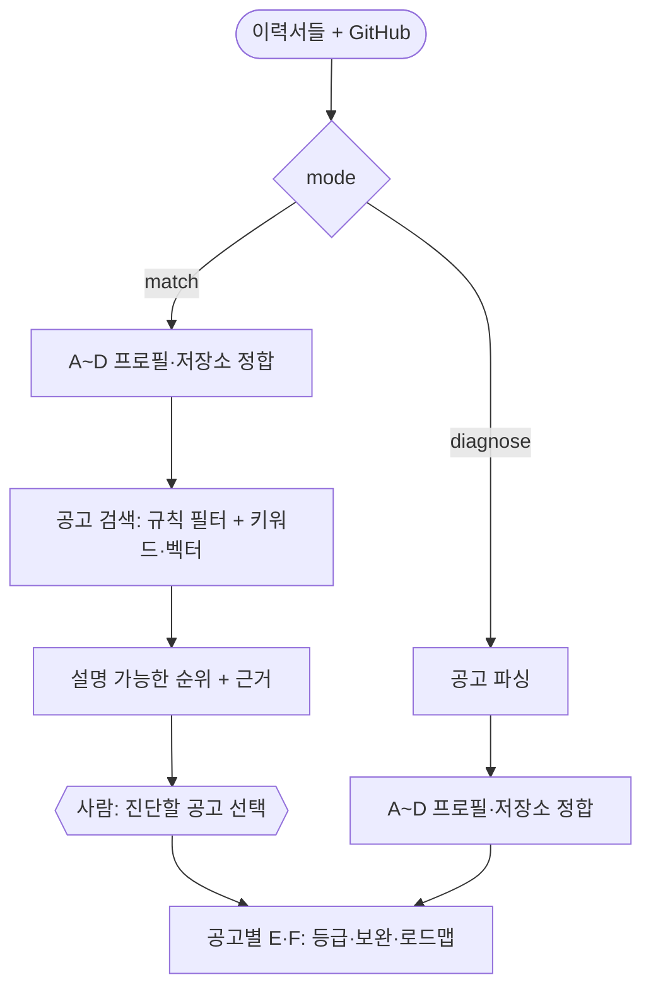

# ADR-0019: 두 진입 경로 — 매칭 / 공고 지정 진단

- 상태: 채택됨 (2026-11-01)
- 날짜: 2026-11-01
- 관련: ADR-0005(개정), ADR-0008, ADR-0009, ADR-0010, ADR-0013, ADR-0016(대체), ADR-0017

## 배경
사용자가 서비스 방향을 정했다. 이력서(들)와 GitHub를 받아 맞는 공고를 찾아 주고, 지원하려는 공고는 서류 단계를 정밀하게 검토한 뒤, 부족하면 이력서와 프로젝트의 보완 사항을 설명한다. 사용자는 "매칭"과 "원하는 공고를 가져와 진단" 중 하나를 고른다. 그래서 ADR-0016(매칭 M4 이연)을 대체한다.

## 결정 1: 경로 분기 방식

| 기준 | **요청의 mode 값으로 규칙 분기** | LLM 라우터가 의도 분류 | 별도 그래프 2개 |
|---|---|---|---|
| 정확도 | 사용자가 고른 대로 (오분류 없음) | 오분류 가능, 평가 필요 | 사용자가 고른 대로 |
| 재현성 (ADR-0008) | 유지 | 약해짐 | 유지 |
| 비용 | 0 | 호출마다 발생 | 0 |
| 공통 단계 재사용 | 조건부 엣지로 공유 | 공유 | 중복 |

**결정**: LangGraph 조건부 엣지에서 요청의 `mode`(`match` / `diagnose`)로 분기한다. 사용자가 화면에서 명시적으로 고르므로 추측할 것이 없다. LLM 라우터는 풀 문제가 없다 (ADR-0009 결정 3과 같은 이유).

## 결정 2: 공고 출처 (비용은 모두 0원)
1. **공공 API**(고용24·워크넷 등)부터 쓰고, 목표 직무 공고가 얼마나 있는지 실측한다.
2. **사용자가 붙여넣은 공고**: 그 사용자 범위로만 저장한다. 매칭 후보에 넣되 다른 사용자와 공유하지 않는다.
3. **기업 채용 페이지 공개 API**: 약관을 확인해 `docs/data-sources.md`에 기록한 뒤 추가한다.
4. **크롤링은 배제한다** (판례, `docs/data-sources.md`).

## 결정 3: 결과 표현
"서류 합격 여부 정밀 검토"는 합격/불합격 판정이나 확률이 아니라 **등급 + 요건별 근거 + 무엇이 바뀌면 등급이 오르는가**로 낸다 (ADR-0013 유지).

## 결정 4: 이력서 여러 개
매칭에는 이력서들의 사실을 합친 하나의 프로필을 쓴다. 공고별 진단에서는 어느 이력서가 더 맞는지 추천한다.

## 결정 5: 비용 통제
매칭 단계의 순위는 규칙과 검색으로만 계산하고 LLM을 쓰지 않는다. LLM 요건 판정은 사용자가 고른 공고에만 쓴다.

## 이유
- 진단 엔진을 그대로 재사용하므로 추가 작업이 공고 수집·검색·순위에 한정된다.
- 벡터 검색이 공고 검색이라는 실제 문제를 맡는다 (ADR-0018 원칙).

## 결과·트레이드오프 (포기한 것)
- 공공 API의 IT 공고 커버리지가 낮으면 매칭 품질이 낮다. 실측 전이라 아직 모른다.
- 공고 DB를 운영해야 한다: 갱신, 마감 제외, 약관 추적.
- 매칭 평가 데이터가 필요하다 → 적합 순위를 설계한 합성 공고 묶음.

## 재검토 조건
- 실측 결과 목표 직무 공고가 너무 적을 때 → 출처 재검토, 또는 사용자가 붙여넣은 공고 위주로 범위 축소.

## 개정 기록 (2026-11-01, ADR-0020)
- 매칭 구현 순서를 에이전트 다음으로 옮긴다 (ADR-0020). 두 진입 경로라는 방향은 그대로다.
